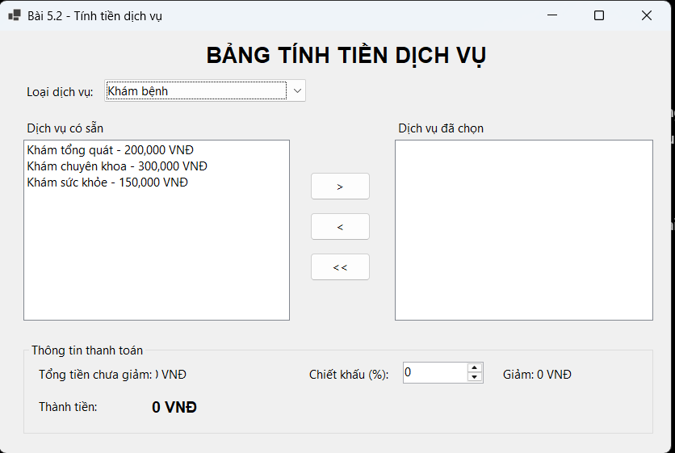
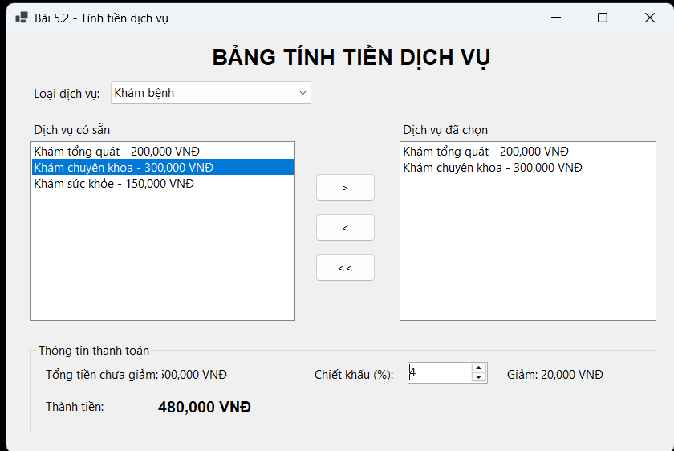
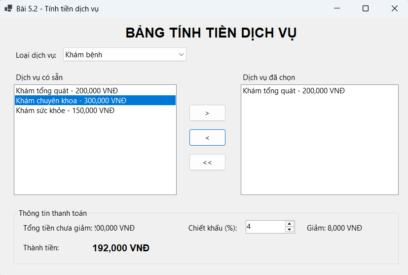

# BÀI 5.2: BẢNG TÍNH TIỀN DỊCH VỤ VÀ CHIẾT KHẤU ĐƠN HÀNG

## THÔNG TIN SINH VIÊN

- **Họ và tên:** Đỗ Quang Toàn
- **Mã số sinh viên:** 34810320100
- **Lớp:** D19QTANM1
- **Môn học:** Lập trình .NET

## KẾT QUẢ THỰC HÀNH

### 1. Giao diện chính

### 2. Chọn dịch vụ và tính tiền

### 3. Kiểm tra chiết khấu và thao tác danh sách

